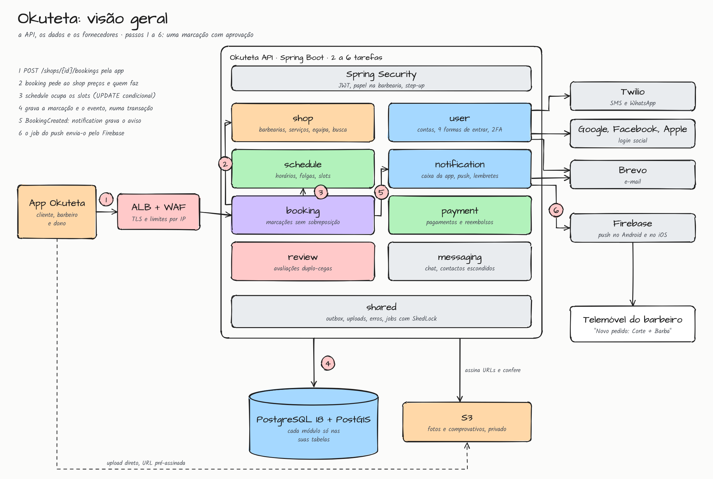
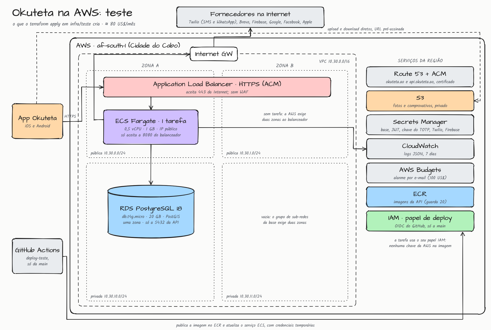
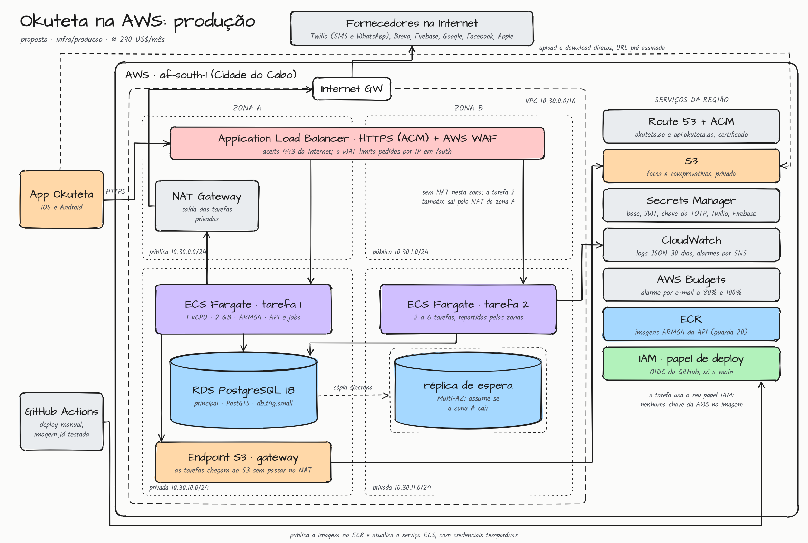

# Okuteta 💈

> 🇬🇧 [Read in English](README.en.md) · [README principal](README.md)

Plataforma de **marcações em barbearias de Angola**. O cliente encontra barbearias perto de si, escolhe um ou mais
serviços e o barbeiro (ou "qualquer um") e marca a hora. A barbearia gere o horário, a equipa, os serviços, a agenda e
os pagamentos que recebe. Preços em kwanzas (AOA), telemóveis `+244` e fuso de Luanda por omissão. O código usa os
nomes em inglês (`shop`, `booking`, `member`); os textos que o utilizador vê usam português de Angola ("marcação",
"telemóvel", "morada").

> **Estado:** design aprovado, **ainda sem código**. Tudo o que este README descreve é o que vai ser construído,
> passo a passo (ver [Próximos passos](#próximos-passos)). O próximo é o passo 0: o esqueleto do projeto.
>
> O system design completo (decisões, modelo de dados com colunas e índices, 145 casos de uso, arquitetura, capacidade
> e operação) está em [docs/design.html](docs/design.html), com um resumo em
> [Modelo de dados e system design](#modelo-de-dados-e-system-design). O projeto segue a mesma linha do Bazza: monólito
> modular, Clean Architecture e cada fornecedor atrás de uma porta.

## Funcionalidades

### Previstas para o MVP

- **Conta:** registo com telemóvel obrigatório (`+244`, móvel), senha opcional, aceitação dos termos (com a versão),
  renovação de sessão, lista e fim das sessões noutros aparelhos, e exclusão com anonimização
- **Login:** nove formas de entrar: e-mail ou telemóvel com senha, código por SMS, código por WhatsApp, link por
  e-mail, Google, Facebook, Apple e passkeys
- **2FA e MFA (opcional para todos):** app autenticadora (TOTP), passkey, código por SMS, WhatsApp ou e-mail, e 10
  códigos de recuperação. Ações sensíveis pedem uma nova confirmação, válida 5 minutos
- **Senha:** recuperação por código (SMS, WhatsApp ou e-mail), que também pede o segundo fator com 2FA ligado, e troca
  de senha com a sessão aberta
- **Perfil:** nome, foto (enviada direto para o S3) e verificação do e-mail
- **Barbearias:** registo pelo dono, morada com coordenadas, horário semanal com turnos, foto de capa e aprovação
  por um administrador antes de aparecer na busca. Cada barbearia escolhe:
  - confirmação na hora (`INSTANT`) ou com aprovação (`MANUAL`);
  - prazo de cancelamento do cliente;
  - intervalo da agenda (10, 15, 20 ou 30 min);
  - fuso horário;
  - antecedência mínima e máxima para marcar;
  - limite de faltas.
- **Equipa:** o dono convida barbeiros pelo telemóvel (convite válido 7 dias). Cada barbeiro tem conta própria e
  define os serviços que faz e se atende marcações
- **Serviços:** nome, duração (múltiplo de 5 min) e preço em kwanzas. Mudar o preço não altera as marcações já feitas
- **Busca:** barbearias aprovadas à volta do cliente (PostGIS), ordenadas pela distância, com a nota e o preço mínimo
- **Agenda:** horário semanal de cada barbeiro, folgas e slots livres gerados para a janela de marcação
- **Marcações:** um ou mais serviços com um barbeiro ou "qualquer um" (sorteio entre os livres), sem marcações
  sobrepostas. Inclui aprovação, recusa, cancelamento pelo cliente (dentro do prazo) ou pela barbearia, conclusão e
  faltas. 3 faltas em 90 dias (ou o que a barbearia definir) impedem marcar nessa barbearia
- **Avaliações duplo-cegas:** o cliente avalia a barbearia e o barbeiro, e o barbeiro avalia o cliente. Nenhum lado
  vê a avaliação do outro até os dois avaliarem ou passarem 14 dias. O dono pode responder em público
- **Notificações:** caixa na app e push no Android e no iOS (Firebase Cloud Messaging) para pedidos, confirmações,
  cancelamentos, lembretes (24 h e 1 h antes), convites, avaliações, pagamentos, reembolsos e mensagens
- **Pagamentos (registo):** o cliente paga direto à barbearia (dinheiro em espécie, Multicaixa Express, Unitel Money,
  Afrimoney ou transferência). A plataforma regista o método, o comprovativo e a confirmação, e mostra à barbearia a
  receita por método e por barbeiro. **Não cobra comissão no MVP**
- **Reembolsos a pedido:** numa marcação paga e depois cancelada, o cliente pede a devolução. A barbearia devolve com
  comprovativo, e o cliente confirma ou contesta. O administrador decide as disputas
- **Mensagens:** conversa entre o cliente e a barbearia (dono e barbeiros), com telefones e e-mails escondidos (`•••`)
- **Administração:** fila de aprovação de barbearias, suspensão e reabertura, avaliações escondidas, disputas de
  pagamento e de reembolso, e desligar o 2FA de quem o perdeu (com 24 h de espera). Os primeiros administradores vêm
  de `ADMIN_PHONES`

### Depois do MVP

Funcionalidades por fase. O que cada fase junta à infraestrutura está no [Roadmap de escala](#roadmap-de-escala).

**Outros serviços de beleza.** O MVP é só de barbearias, mas o Okuteta pode alargar a qualquer momento a maquilhagem,
unhas e nail art, massagem e estética. Nada disso se constrói agora. O código segue três regras para esse dia não
obrigar a refazer nada:

- nada de barbearia no domínio: nenhum enum de serviços, nenhuma regra que só valha para cortes;
- as palavras da app ("barbearia", "barbeiro") ficam nos ficheiros de mensagens, não em nomes de classes nem em regras;
- a porta da agenda recebe o "dono da agenda" (hoje, sempre um barbeiro), para mais tarde poder ser uma sala ou uma maca.

O que mudaria (categorias, tempo de preparação, preço "a partir de", salas e macas, sinal, domicílio, marca) está no
design, em "Outros serviços de beleza".

- **Fase 2:**
  - reagendar sem cancelar;
  - lista de espera;
  - modelo de receita (assinatura da barbearia ou comissão);
  - denúncias e moderação;
  - exportação dos dados pessoais;
  - aprovação do segundo fator por push.
- **Fase 3:**
  - pagamento eletrónico por um agregador angolano, com reembolso automático;
  - Redis para cache;
  - CDN para as fotos públicas;
  - réplica de leitura;
  - particionamento mensal das mensagens, das notificações e dos slots.

## Tecnologias

| Tecnologia        | Versão |
|-------------------|--------|
| Java              | 25 (virtual threads) |
| Spring Boot       | 4.x    |
| Spring Security   | 7.x (OAuth2 Resource Server, JWT) |
| Spring Data JPA   | Hibernate 7.x |
| PostgreSQL        | 18, com PostGIS |
| Flyway            | —      |
| webauthn4j        | passkeys |
| libphonenumber    | telemóveis e máscara no chat |
| Docker Compose    | ambiente local (PostGIS e MinIO) |
| H2                | só nos testes |
| Maven             | via wrapper `./mvnw` |

As versões exatas ficam fixadas no `pom.xml` no passo 0.

Serviços externos: **Twilio** (SMS e WhatsApp), **Brevo** (e-mail por SMTP), **Firebase** (push), **Google**,
**Facebook** e **Apple** (login social) e **AWS S3** (ficheiros). Em desenvolvimento, todos são opcionais: os códigos e
os e-mails vão para o log, e os ficheiros para o MinIO.

## Como rodar

> Ainda não há código. Os comandos abaixo são os que o passo 0 vai deixar a funcionar.

### Pré-requisitos

- JDK 25 (`java -version`)
- Docker (Docker Desktop ou Colima), para o PostgreSQL com PostGIS e o MinIO
- Não é preciso instalar o Maven: o projeto vai usar o wrapper `./mvnw`

### Com Docker

```bash
# banco (PostgreSQL 18 + PostGIS) e MinIO no Docker; a aplicação roda pelo Maven
docker compose up -d
./mvnw spring-boot:run          # http://localhost:8080, perfil dev

# tudo no Docker (banco, MinIO e aplicação)
docker compose --profile app up -d --build

# parar, ou parar e apagar os dados
docker compose --profile app down
docker compose --profile app down -v
```

### Comandos

```bash
./mvnw compile                                  # compilar
./mvnw test                                     # testes em H2 (sem Docker)
./mvnw test -Dokuteta.test.postgres=true        # os mesmos testes num PostgreSQL 18 + PostGIS (Testcontainers)
./mvnw spring-boot:run                          # subir a aplicação
```

- **Testes em H2:** os testes correm em H2 por omissão, sem banco nem Docker, e não enviam SMS, WhatsApp nem e-mail.
- **Busca com PostGIS:** o teste da busca precisa do PostGIS, por isso só corre com `-Dokuteta.test.postgres=true`,
  que é como o CI corre.
- **Regras de arquitetura:** o `ArchitectureTest` (ArchUnit) verifica-as a cada build:
  - um módulo não acede às tabelas nem aos repositórios de outro;
  - o domínio não depende de Spring, JPA nem infraestrutura;
  - o `shared` não conhece os módulos.

**Documentação da API (Swagger):** com a aplicação no ar, em **http://localhost:8080/swagger-ui.html**, e o JSON da
especificação em **/v3/api-docs**. Só abre no perfil `dev`, ou com `OPENAPI_ENABLED=true`.

**Saúde:** `GET /actuator/health` responde `UP` ou `DOWN` (confere só o PostgreSQL), sem token, para o balanceador.

### Integração contínua

O GitHub Actions vai rodar em todo pull request para a `main` e em todo push nela:

1. **Testes:** compila e corre todos os testes com o JDK 25 num PostgreSQL 18 + PostGIS de verdade (Testcontainers),
   incluindo o ArchUnit.
2. **Migrations:** recusa alterar uma migration já existente e, nas novas, mudanças que partem a versão anterior
   durante um deploy sem parar (apagar, renomear ou mudar o tipo de uma coluna).
3. **Imagem Docker:** confere que a imagem ARM64 é construída.

O deploy no ambiente de teste da AWS usa OIDC (sem chaves guardadas) e só corre a partir da `main`. A produção só
recebe imagens já testadas, por um deploy manual.

## Configuração

### Ficheiros

| Ficheiro | Uso |
|---|---|
| `src/main/resources/application.properties` | Configuração comum. Não define perfil: o jar e a imagem sobem sem o `dev` |
| `src/main/resources/application-dev.properties` | Valores de desenvolvimento e leitura do `.env` |
| `src/test/resources/application.properties` | H2 e senders de teste |
| `.env` | Variáveis locais e credenciais. **Fora do git.** Criado a partir do `.env.example` |

**Nunca ativar o perfil `dev` em produção:** ele traz segredos fixos (JWT e chave de cifra) e escreve os códigos no
log. Com o `dev`, a aplicação vai recusar arrancar se o banco não for local.

### Variáveis de ambiente

Os nomes abaixo são a proposta e ficam definitivos no passo 0. No perfil `dev`, todas têm valor por omissão. Fora
dele, as **obrigatórias** precisam de estar definidas, ou a aplicação recusa arrancar e diz o que falta.

| Variável | Obrigatória | Para quê |
|---|---|---|
| `DB_URL`, `DB_USERNAME`, `DB_PASSWORD` | sim | PostgreSQL |
| `JWT_SECRET` | sim | Assinatura dos tokens (acesso, registo social, 2FA) |
| `ADMIN_PHONES` | não | Telemóveis verificados cujas contas passam a ADMIN no arranque (separados por vírgulas) |
| `TERMS_VERSION` | sim | Versão atual dos termos; quem aceitou uma anterior tem de aceitar de novo |
| `CRYPTO_KEY` | sim | Chave AES-256-GCM dos segredos TOTP |
| `PUBLIC_BASE_URL` | sim | Domínio dos links por e-mail (ex.: `https://okuteta.ao`) |
| `EMAIL_SENDER` | não | `smtp` (Brevo) ou `log` |
| `MAIL_FROM`, `SMTP_HOST`, `SMTP_USERNAME`, `SMTP_PASSWORD` | com `smtp` | Brevo |
| `SMS_SENDER` | não | `twilio` ou `log` |
| `TWILIO_ACCOUNT_SID`, `TWILIO_AUTH_TOKEN`, `TWILIO_FROM` | com `twilio` | SMS |
| `TWILIO_WHATSAPP_FROM`, `TWILIO_WHATSAPP_TEMPLATE_SID` | não | WhatsApp; sem eles, a app só oferece SMS |
| `GOOGLE_CLIENT_IDS` | não | IDs dos clientes OAuth da Google (Android, iOS) |
| `APPLE_CLIENT_IDS`, `APPLE_TEAM_ID`, `APPLE_KEY_ID`, `APPLE_PRIVATE_KEY` | não | Sign in with Apple e revogação na exclusão da conta |
| `FACEBOOK_APP_ID`, `FACEBOOK_APP_SECRET` | não | Login com Facebook |
| `PASSKEY_RP_ID` | não | Domínio das passkeys (ex.: `okuteta.ao`). Trocar depois invalida as passkeys |
| `IOS_APP_IDS`, `ANDROID_PACKAGE_NAME`, `ANDROID_CERT_FINGERPRINTS` | não | Ficheiros `/.well-known` para as passkeys e os links abrirem a app |
| `FCM_SERVICE_ACCOUNT` | não | Conta de serviço do Firebase (JSON) para o push |
| `STORAGE_TYPE` | não | `s3` (AWS ou MinIO) |
| `S3_BUCKET`, `AWS_REGION`, `S3_ENDPOINT` | com `s3` | Bucket; `S3_ENDPOINT` só para o MinIO |
| `LOG_FORMAT` | não | `json` para logs estruturados |
| `OPENAPI_ENABLED` | não | Liga o Swagger fora do `dev` |

### Sem provedores configurados

Sem Twilio, Brevo, Firebase ou login social, a aplicação sobe na mesma:

- os códigos e os e-mails vão para o log (só no `dev`);
- o push fica `SKIPPED`;
- os endpoints de um provedor sem configuração respondem **503**.

Assim dá para desenvolver sem nenhuma conta externa.

### Migrations

O Flyway corre no arranque:

- **Migrations comuns:** `src/main/resources/db/migration`. Correm no H2 e no PostgreSQL, por isso não usam índices
  parciais nem `EXCLUDE`.
- **Só PostgreSQL:** `db/migration/postgresql` traz o que o H2 não tem, como a extensão PostGIS e a coluna gerada
  `shops.location`, com índice GiST.
- **Deploy sem parar:** cada mudança é compatível com a versão anterior (expandir, migrar, contrair).

## API

### Autenticação

A API é stateless e autenticada por **JWT**. Todos os endpoints ficam sob `/api/v1`. O login devolve:

- `accessToken`: vale 15 minutos e vai no cabeçalho `Authorization: Bearer <token>`. Leva `amr` (os métodos usados no
  login) e `auth_time`.
- `refreshToken`: vale 30 dias e serve só para pedir tokens novos em `/auth/refresh`. A cada uso é trocado por outro.
  Se um refresh token já usado aparecer de novo, a sessão inteira é revogada.

Há dois tokens intermédios, cada um com o seu público (`aud`), que não valem como sessão:

- `signupToken` (15 min, `aud: okuteta-signup`): uma conta nova pelo login social usa-o para completar o registo
  com o telemóvel.
- `mfaToken` (5 min, `aud: okuteta-mfa`): com 2FA ligado, o primeiro fator devolve-o em vez da sessão, e
  `/auth/mfa/verify` troca-o pela sessão.

O telefone é **obrigatório** e conferido no plano de numeração com a libphonenumber. Um número que não existe, ou um
fixo, é recusado (**422**). O login com telemóvel só funciona depois de o verificar. Antes disso, a API responde como
se o número não existisse.

### Convenções

| Tema | Regra | Exemplo |
|---|---|---|
| Nomes | Caminhos, parâmetros de query e campos do JSON em inglês; JSON em camelCase. Os textos para a pessoa (erros, avisos) em português | `GET /shops/{id}/availability?date=2026-11-07&serviceIds=…` |
| Paginação | Por cursor nas listas que crescem: `?limit=` (20 por omissão, máximo 100) e `?cursor=`. A resposta traz `nextCursor`, nulo na última página. Do mais recente para o mais antigo por omissão | `{ "items": [ … ], "nextCursor": "MjAy…" }` |
| Instantes | ISO 8601 em UTC nas respostas; nos pedidos aceita-se o deslocamento | `"startsAt": "2026-11-07T10:30:00Z"` |
| Dias e horas da agenda | Locais, no fuso da barbearia, que vem na resposta | `"date": "2026-11-07", "start": "11:30", "timezone": "Africa/Luanda"` |
| Dinheiro | Inteiros em cêntimos, com a moeda | `"totalCents": 450000, "currency": "AOA"` |
| Repetir um pedido | Criar marcação aceita `Idempotency-Key`. As operações de pagamento e reembolso são seguras por estado: repetidas, devolvem o estado atual em vez de erro. As mensagens usam `clientMessageId` | `Idempotency-Key: 6f1c2a9e-…` |
| Versões | Tudo sob `/api/v1`. Campos novos não mudam a versão; uma mudança que parte a app vai para `/api/v2`, com as duas no ar durante 6 meses | `/api/v1/…` |

### Endpoints

Todos previstos. A lista completa, com os campos de cada pedido e resposta, vai estar no Swagger. `job` são tarefas
agendadas (com ShedLock), `evento` reage a eventos de outros módulos e `público` é chamado por outro módulo, sem
endpoint.

<!-- generated:usecases -->
**Utilizadores** (`user`)

| Caso de uso | Tipo | Endpoint | Quem | O que faz |
|---|---|---|---|---|
| `RegisterUser` | endpoint | `POST /api/v1/auth/register` | Visitante | Cria a conta com nome, telemóvel (+244, móvel, conferido com libphonenumber), e-mail opcional e senha opcional (Argon2id), aceita a versão atual dos termos, e envia o código pelo canal escolhido (SMS ou WhatsApp). |
| `SendPhoneCode` | endpoint | `POST /api/v1/auth/phone/code` | Visitante | Reenvia o código por SMS ou WhatsApp (válido 10 min; 1 por minuto e 5 por dia). |
| `VerifyPhone` | endpoint | `POST /api/v1/auth/phone/verify` | Visitante | Confere o código (até 5 tentativas), marca o telemóvel como verificado e devolve a sessão. |
| `LoginWithPassword` | endpoint | `POST /api/v1/auth/login` | Visitante | Entra com o e-mail ou o telemóvel verificado e a senha. 5 erros bloqueiam 15 min. Com 2FA ligado, devolve um `mfaToken` em vez da sessão. |
| `RequestLoginCode` | endpoint | `POST /api/v1/auth/code` | Visitante | Envia um código de login por SMS ou WhatsApp para um telemóvel verificado +244. A resposta é igual com ou sem conta. |
| `LoginWithCode` | endpoint | `POST /api/v1/auth/code/verify` | Visitante | Confere o código e devolve a sessão, ou o `mfaToken` com 2FA ligado. |
| `RequestLoginLink` | endpoint | `POST /api/v1/auth/link` | Visitante | Envia para um e-mail confirmado um link de uso único, válido 15 min, que abre a app. No máximo 3 por hora. |
| `LoginWithLink` | endpoint | `POST /api/v1/auth/link/verify` | Visitante | A app envia o token do link por POST. Abrir o link (GET) não o consome. |
| `LoginWithGoogle` | endpoint | `POST /api/v1/auth/google` | Visitante | Valida o idToken com as chaves da Google (público e nonce). Uma conta nova recebe um token de registo de 15 min (`aud: okuteta-signup`). |
| `LoginWithFacebook` | endpoint | `POST /api/v1/auth/facebook` | Visitante | Confere o access token na Graph API (`debug_token`, `/me`) ou valida o JWT do Limited Login no iOS. |
| `LoginWithApple` | endpoint | `POST /api/v1/auth/apple` | Visitante | Valida o identityToken com as chaves da Apple e confere o nonce. |
| `CompleteSocialSignup` | endpoint | `POST /api/v1/auth/social/complete` | Visitante com token de registo | Pede o telemóvel (obrigatório) e, se quiser, uma senha, e envia o código. |
| `StartPasskeyLogin` | endpoint | `POST /api/v1/auth/passkey/options` | Visitante | Cria um desafio de uso único (5 min) para credencial descoberta. |
| `FinishPasskeyLogin` | endpoint | `POST /api/v1/auth/passkey/verify` | Visitante | Confere a assinatura, a origem, a verificação do utilizador e o contador. Devolve a sessão sem segundo fator. |
| `SendMfaCode` | endpoint | `POST /api/v1/auth/mfa/code` | Visitante com mfaToken | Envia o código do segundo fator por SMS, WhatsApp ou e-mail, num canal diferente do primeiro. |
| `VerifyMfa` | endpoint | `POST /api/v1/auth/mfa/verify` | Visitante com mfaToken | Aceita um código TOTP, SMS, WhatsApp, de e-mail ou de recuperação, ou uma passkey, e devolve a sessão com `amr` e `auth_time`. |
| `StepUp` | endpoint | `POST /api/v1/auth/step-up` | Utilizador | Confirma de novo com a senha, uma passkey, a app ou um código, e devolve um JWT com `auth_time` de agora, válido 5 min para ações sensíveis. Recusado nas 24 h a seguir a um `ResetMfaByAdmin`. |
| `RefreshSession` | endpoint | `POST /api/v1/auth/refresh` | Utilizador | Roda o refresh token sem pedir o segundo fator. O reuso de um token antigo revoga a família inteira. |
| `Logout` | endpoint | `POST /api/v1/auth/logout` | Utilizador | Revoga a sessão do aparelho. |
| `ListSessions` | endpoint | `GET /api/v1/me/sessions` | Utilizador | Lista os aparelhos com sessão, os métodos usados e o último uso. |
| `RevokeSession` | endpoint | `DELETE /api/v1/me/sessions/{id}` | Utilizador | Termina a sessão de outro aparelho. |
| `RequestPasswordReset` | endpoint | `POST /api/v1/auth/password/code` | Visitante | Envia um código por SMS, WhatsApp ou e-mail. A resposta é igual com ou sem conta. |
| `ResetPassword` | endpoint | `POST /api/v1/auth/password/reset` | Visitante | Troca a senha e encerra todas as sessões. Com 2FA ligado, pede também o segundo fator. |
| `StartTotpEnrollment` | endpoint | `POST /api/v1/me/mfa/totp` | Utilizador, com confirmação | Gera o segredo e devolve o `otpauth://` para o QR code. |
| `ConfirmTotpEnrollment` | endpoint | `POST /api/v1/me/mfa/totp/confirm` | Utilizador | Confere o primeiro código, liga o 2FA e devolve 10 códigos de recuperação, mostrados uma única vez. |
| `RegenerateRecoveryCodes` | endpoint | `POST /api/v1/me/mfa/recovery-codes` | Utilizador, com confirmação | Invalida os códigos antigos e gera 10 novos. |
| `DisableMfa` | endpoint | `DELETE /api/v1/me/mfa` | Utilizador, com confirmação | Desliga o 2FA e apaga o TOTP e os códigos de recuperação. |
| `StartPasskeyRegistration` | endpoint | `POST /api/v1/me/passkeys/options` | Utilizador, com confirmação | Cria o desafio de registo, excluindo as credenciais que a pessoa já tem. |
| `FinishPasskeyRegistration` | endpoint | `POST /api/v1/me/passkeys` | Utilizador | Confere a atestação e guarda a passkey com o nome escolhido. |
| `ListPasskeys` | endpoint | `GET /api/v1/me/passkeys` | Utilizador | Mostra o nome, a data de criação e o último uso de cada passkey. |
| `RenamePasskey` | endpoint | `PATCH /api/v1/me/passkeys/{id}` | Utilizador | Muda o nome da passkey. |
| `DeletePasskey` | endpoint | `DELETE /api/v1/me/passkeys/{id}` | Utilizador, com confirmação | Apaga a passkey, mas nunca a última forma de entrar. |
| `LinkSocialIdentity` | endpoint | `POST /api/v1/me/identities/{provider}` | Utilizador, com confirmação | Liga uma conta Google, Facebook ou Apple, que não pode estar ligada a outra pessoa. |
| `UnlinkSocialIdentity` | endpoint | `DELETE /api/v1/me/identities/{provider}` | Utilizador, com confirmação | Desliga a conta social, mas nunca a última forma de entrar. |
| `GetMyProfile` | endpoint | `GET /api/v1/me` | Utilizador | Devolve a conta, as formas de entrar, o estado do 2FA, as barbearias onde é dono ou barbeiro e os convites pendentes. |
| `UpdateProfile` | endpoint | `PATCH /api/v1/me` | Utilizador | Altera o nome. Trocar o telemóvel ou o e-mail pede confirmação e um código novo. |
| `SetAvatar` | endpoint | `PUT /api/v1/me/avatar` | Utilizador | Recebe a key do upload e confere que é JPG ou PNG até 5 MB. |
| `VerifyEmail` | endpoint | `POST /api/v1/me/email/verify` | Utilizador | Confirma o e-mail com um código. |
| `ChangePassword` | endpoint | `PUT /api/v1/me/password` | Utilizador, com confirmação | Define ou troca a senha. |
| `DeleteAccount` | endpoint | `DELETE /api/v1/me` | Utilizador, com confirmação | Anonimiza a conta e publica `UserAccountDeleted`. Um dono com barbearia ativa tem de a fechar primeiro. |
| `GetAccountStatus` | público | — | booking, shop | Devolve o estado da conta e se o telemóvel está verificado, para marcar e para criar barbearia. |
| `FindUserByPhone` | público | — | shop | Devolve a conta com esse telemóvel verificado, se existir, para avisar quem é convidado. |
| `AcceptTerms` | endpoint | `POST /api/v1/me/terms` | Utilizador | Aceita a versão atual dos termos (`TERMS_VERSION`). Enquanto não aceitar, a API responde 403 `TERMS_REQUIRED` a tudo menos `/auth/*` e `/me/terms`. |
| `ResetMfaByAdmin` | endpoint | `POST /api/v1/admin/users/{id}/mfa/reset` | Administrador | Desliga o 2FA de quem perdeu a app e os códigos, depois de confirmar a identidade fora da app (por exemplo, videochamada com o BI). Grava quem o fez; a conta fica 24 h sem ações sensíveis e recebe avisos por SMS e e-mail. |
| `PromoteAdmins` | job | no arranque | Sistema | As contas cujo telemóvel verificado está em `ADMIN_PHONES` passam a ADMIN; quem saiu da lista volta a USER. |
| `PurgeExpiredChallenges` | job | diário | Sistema | Apaga os códigos e os desafios WebAuthn expirados há mais de 1 dia. |

**Barbearias** (`shop`)

| Caso de uso | Tipo | Endpoint | Quem | O que faz |
|---|---|---|---|---|
| `CreateShop` | endpoint | `POST /api/v1/shops` | Utilizador verificado | Cria a barbearia em DRAFT e o dono como membro OWNER. |
| `UpdateShop` | endpoint | `PATCH /api/v1/shops/{id}` | Dono | Altera nome, morada, coordenadas, modo de confirmação, prazo de cancelamento, fuso, intervalo dos slots, antecedência e regra de faltas. Mudar o fuso ou o intervalo publica `ShopScheduleChanged`. |
| `SetShopCover` | endpoint | `PUT /api/v1/shops/{id}/cover` | Dono | Recebe a key do upload da foto de capa. |
| `SetOpeningHours` | endpoint | `PUT /api/v1/shops/{id}/opening-hours` | Dono | Define o horário semanal, com turnos (por exemplo 08:00–12:30 e 14:00–19:00). |
| `SubmitShopForReview` | endpoint | `POST /api/v1/shops/{id}/submit` | Dono | Exige morada, horário, um serviço e um barbeiro que atende; a barbearia passa a PENDING_REVIEW. |
| `ListPendingShops` | endpoint | `GET /api/v1/admin/shops?status=PENDING_REVIEW` | Administrador | Lista a fila de aprovação, das mais antigas para as mais recentes. |
| `ApproveShop` | endpoint | `POST /api/v1/admin/shops/{id}/approve` | Administrador | Passa a APPROVED e entra na busca. Publica `ShopApproved`. |
| `RejectShop` | endpoint | `POST /api/v1/admin/shops/{id}/reject` | Administrador | Passa a REJECTED com motivo. O dono corrige e volta a submeter. |
| `SuspendShop` | endpoint | `POST /api/v1/admin/shops/{id}/suspend` | Administrador | Sai da busca. `ShopSuspended` cancela as marcações futuras. |
| `ReinstateShop` | endpoint | `POST /api/v1/admin/shops/{id}/reinstate` | Administrador | SUSPENDED → APPROVED, com motivo: volta à busca e aceita marcações. As marcações canceladas não voltam. Publica `ShopReinstated`. |
| `SearchShops` | endpoint | `GET /api/v1/shops?lat=&lng=&radius=&q=` | Visitante | Faz a query PostGIS: barbearias aprovadas dentro do raio, ordenadas pela distância, com a nota e o preço mínimo. |
| `GetShop` | endpoint | `GET /api/v1/shops/{id}` | Visitante | Mostra o perfil público: horário, serviços, barbeiros, nota, contas de pagamento e regra de cancelamento. |
| `CreateService` | endpoint | `POST /api/v1/shops/{id}/services` | Dono | Cria um serviço com nome, duração (múltiplo de 5 min) e preço em kwanzas. |
| `UpdateService` | endpoint | `PATCH /api/v1/shops/{id}/services/{serviceId}` | Dono | O novo preço e a nova duração valem só para marcações novas. |
| `DeactivateService` | endpoint | `DELETE /api/v1/shops/{id}/services/{serviceId}` | Dono | Esconde o serviço. As marcações existentes mantêm-se. |
| `InviteBarber` | endpoint | `POST /api/v1/shops/{id}/invites` | Dono | Convida pelo telemóvel, por 7 dias. Quem já tem conta recebe um aviso. |
| `RevokeInvite` | endpoint | `DELETE /api/v1/shops/{id}/invites/{inviteId}` | Dono | Cancela um convite pendente. |
| `ListMyInvites` | endpoint | `GET /api/v1/me/invites` | Utilizador | Lista os convites para o telemóvel verificado da conta. |
| `AcceptInvite` | endpoint | `POST /api/v1/invites/{id}/accept` | Convidado | Torna-se membro BARBER (ou reativa a linha de quem já esteve). O telemóvel verificado da conta tem de ser o do convite. |
| `DeclineInvite` | endpoint | `POST /api/v1/invites/{id}/decline` | Convidado | Recusa o convite. |
| `UpdateMember` | endpoint | `PATCH /api/v1/shops/{id}/members/{memberId}` | Dono ou o próprio | Altera o nome de apresentação, a bio e se atende marcações. |
| `SetMemberServices` | endpoint | `PUT /api/v1/shops/{id}/members/{memberId}/services` | Dono | Define os serviços que este barbeiro faz. |
| `RemoveMember` | endpoint | `DELETE /api/v1/shops/{id}/members/{memberId}` | Dono, ou o próprio para sair | Passa a REMOVED. `MemberRemoved` cancela as marcações futuras e apaga os slots. O dono não sai. |
| `GetShopBookingRules` | público | — | booking, schedule | Devolve o estado, o modo de confirmação, o prazo de cancelamento, o intervalo, o fuso, a antecedência, a regra de faltas e o horário da barbearia. |
| `QuoteServices` | público | — | booking, schedule | Devolve o preço e a duração dos serviços pedidos e os barbeiros ativos que fazem todos. |
| `GetShopRole` | público | — | booking, schedule, payment, messaging | Devolve o papel de uma pessoa na barbearia (OWNER, BARBER ou nenhum), para autorizar os pedidos. |
| `ExpireInvites` | job | diário | Sistema | Convites PENDING com mais de 7 dias passam a EXPIRED. |
| `OnUserAccountDeleted` | evento | UserAccountDeleted | Sistema | Remove a pessoa das barbearias onde é barbeiro. |

**Agenda** (`schedule`)

| Caso de uso | Tipo | Endpoint | Quem | O que faz |
|---|---|---|---|---|
| `SetWorkingHours` | endpoint | `PUT /api/v1/members/{id}/working-hours` | Barbeiro ou dono | Define o horário semanal (dentro do da barbearia) e regenera os slots livres. Responde 409 se uma marcação ficar fora do novo horário. |
| `AddTimeOff` | endpoint | `POST /api/v1/members/{id}/time-off` | Barbeiro ou dono | Marca folga, férias ou pausa e apaga os slots livres do período. Responde 409 se houver marcações no período. |
| `RemoveTimeOff` | endpoint | `DELETE /api/v1/members/{id}/time-off/{timeOffId}` | Barbeiro ou dono | Volta a gerar os slots do período. |
| `ListTimeOff` | endpoint | `GET /api/v1/members/{id}/time-off?from=&to=` | Barbeiro ou dono | Lista as folgas no período. |
| `GetAvailability` | endpoint | `GET /api/v1/shops/{id}/availability?date=&serviceIds=&memberId=` | Visitante | Lê os slots livres do dia e devolve os inícios com slots seguidos suficientes para a soma das durações, respeitando a antecedência mínima. Sem barbeiro, mostra a união dos que fazem os serviços. |
| `ReserveSlots` | público | — | booking | Recebe o dono da agenda (hoje, sempre um barbeiro; mais tarde também uma sala ou maca) e ocupa os slots do intervalo com `UPDATE … WHERE booking_id IS NULL` e confere o número de linhas. Se faltar alguma, a marcação falha com 409. |
| `GenerateSlots` | job | diário | Sistema | Gera, para cada barbeiro e no fuso da barbearia, os slots de todos os dias da janela (`max_advance_days`) que ainda não os têm. Uma corrida perdida corrige-se na seguinte. |
| `PurgePastSlots` | job | diário | Sistema | Apaga os slots com mais de 7 dias. |
| `OnBookingEnded` | evento | BookingCancelled, BookingRejected, BookingExpired | Sistema | Liberta os slots (`booking_id = NULL`). |
| `OnShopScheduleChanged` | evento | ShopScheduleChanged | Sistema | Regenera os slots livres de todos os barbeiros da barbearia com o novo intervalo ou fuso, sem tocar nos ocupados. |
| `OnMemberRemoved` | evento | MemberRemoved | Sistema | Apaga os slots futuros do barbeiro. |

**Marcações** (`booking`)

| Caso de uso | Tipo | Endpoint | Quem | O que faz |
|---|---|---|---|---|
| `CreateBooking` | endpoint | `POST /api/v1/shops/{id}/bookings` | Cliente verificado | Recebe os serviços, o início, o barbeiro (ou nenhum) e o método de pagamento. Trava os candidatos por ordem de id, sorteia um com os slots livres, chama `ReserveSlots` e cria CONFIRMED (INSTANT) ou PENDING (MANUAL). Aceita `Idempotency-Key`. Recusa se o cliente atingiu o limite de faltas dessa barbearia. |
| `GetBooking` | endpoint | `GET /api/v1/bookings/{id}` | Cliente, barbeiro ou dono | Mostra o detalhe com os serviços e preços copiados. Para a barbearia, inclui a nota do cliente. |
| `ListMyBookings` | endpoint | `GET /api/v1/me/bookings?status=&cursor=` | Cliente | Lista as próximas e as passadas, paginadas por cursor. |
| `ListShopAgenda` | endpoint | `GET /api/v1/shops/{id}/agenda?date=&memberId=` | Dono ou barbeiro | Mostra a agenda do dia: o barbeiro vê só a sua, o dono vê todas. |
| `ApproveBooking` | endpoint | `POST /api/v1/bookings/{id}/approve` | Dono ou barbeiro atribuído | Passa de PENDING a CONFIRMED. |
| `RejectBooking` | endpoint | `POST /api/v1/bookings/{id}/reject` | Dono ou barbeiro atribuído | Passa de PENDING a REJECTED, com motivo, e liberta os slots. Também em "qualquer um": não passa a outro barbeiro, e o aviso ao cliente leva um atalho para os outros horários. |
| `CancelBookingByCustomer` | endpoint | `POST /api/v1/bookings/{id}/cancel` | Cliente | Cancela até `cancel_notice_hours` antes do início. Depois disso responde 409 e só a barbearia cancela. |
| `CancelBookingByShop` | endpoint | `POST /api/v1/shops/{id}/bookings/{bookingId}/cancel` | Dono ou barbeiro atribuído | Cancela a qualquer momento antes do início, com motivo obrigatório. |
| `CompleteBooking` | endpoint | `POST /api/v1/bookings/{id}/complete` | Dono ou barbeiro atribuído | A partir da hora de início, passa a COMPLETED e publica `BookingCompleted`. |
| `MarkNoShow` | endpoint | `POST /api/v1/bookings/{id}/no-show` | Dono ou barbeiro atribuído | 15 min depois do início, passa a NO_SHOW e conta para o limite de faltas dessa barbearia. |
| `ExpirePendingBookings` | job | a cada minuto | Sistema | Marcações PENDING sem resposta até `pending_expires_at` passam a EXPIRED. |
| `AutoCompleteBookings` | job | de hora em hora | Sistema | Marcações CONFIRMED que acabaram há mais de 12 h passam a COMPLETED. |
| `GetBookingParticipants` | público | — | review, payment | Devolve o cliente, o barbeiro, a barbearia, o estado e a data de conclusão. |
| `HasBookingWithShop` | público | — | messaging | Diz se o cliente tem ou teve uma marcação nessa barbearia. |
| `OnMemberRemoved` | evento | MemberRemoved | Sistema | Cancela (SYSTEM) as marcações futuras do barbeiro. |
| `OnShopSuspended` | evento | ShopSuspended | Sistema | Cancela as marcações futuras da barbearia. |
| `OnUserAccountDeleted` | evento | UserAccountDeleted | Sistema | Cancela as marcações futuras do cliente. |

**Avaliações** (`review`)

| Caso de uso | Tipo | Endpoint | Quem | O que faz |
|---|---|---|---|---|
| `ReviewShop` | endpoint | `POST /api/v1/bookings/{id}/review` | Cliente | Até 14 dias depois de COMPLETED, avalia a barbearia e o barbeiro de 1 a 5, com comentário. Fica escondida até a barbearia avaliar ou o prazo acabar. |
| `ReviewCustomer` | endpoint | `POST /api/v1/bookings/{id}/customer-review` | Barbeiro atribuído ou dono | Avalia o cliente de 1 a 5, com comentário. Quando os dois lados avaliaram, publica as duas avaliações. |
| `PublishExpiredReviews` | job | de hora em hora | Sistema | Publica as avaliações cujo prazo de 14 dias acabou, mesmo sem a do outro lado. |
| `ReplyToReview` | endpoint | `POST /api/v1/reviews/{id}/reply` | Dono | Dá uma resposta pública a uma avaliação publicada da barbearia. |
| `ListShopReviews` | endpoint | `GET /api/v1/shops/{id}/reviews` | Visitante | Lista as publicadas, das mais recentes para as mais antigas. |
| `ListMemberReviews` | endpoint | `GET /api/v1/members/{id}/reviews` | Visitante | Lista as avaliações do barbeiro. |
| `GetCustomerRating` | público | — | booking | Devolve a nota e o número de avaliações do cliente. |
| `HideReview` | endpoint | `POST /api/v1/admin/reviews/{id}/hide` | Administrador | Esconde uma avaliação ofensiva ou falsa, com motivo. |
| `RecalculateRating` | evento | ReviewPublished, ReviewHidden | Sistema | Recalcula `rating_stats` da barbearia, do barbeiro ou do cliente a partir das publicadas. |
| `OnUserAccountDeleted` | evento | UserAccountDeleted | Sistema | O nome do autor passa a "Utilizador removido". |

**Notificações** (`notification`)

| Caso de uso | Tipo | Endpoint | Quem | O que faz |
|---|---|---|---|---|
| `RegisterDevice` | endpoint | `POST /api/v1/me/devices` | Utilizador | Regista o token FCM do aparelho. |
| `UnregisterDevice` | endpoint | `DELETE /api/v1/me/devices/{token}` | Utilizador | Apaga o token quando a pessoa sai da conta. |
| `ListNotifications` | endpoint | `GET /api/v1/me/notifications` | Utilizador | Mostra a caixa da app, paginada por cursor. |
| `MarkNotificationRead` | endpoint | `POST /api/v1/me/notifications/{id}/read` | Utilizador | Marca um aviso como lido. |
| `MarkAllRead` | endpoint | `POST /api/v1/me/notifications/read-all` | Utilizador | Marca todos os avisos como lidos. |
| `NotificationEventListener` | evento | vários | Sistema | Grava o aviso na transação do evento: marcação pedida, confirmada, recusada, cancelada (com convite para pedir o reembolso, se foi paga), expirada ou concluída (convite para avaliar), avaliações publicadas, convite de barbeiro, barbearia aprovada, recusada ou reaberta, pagamento declarado, reembolso pedido ou enviado, mensagem nova e avisos de segurança (login num aparelho novo, 2FA ligado ou desligado, código de recuperação usado), estes também por e-mail. |
| `DeliverPush` | job | a cada 5 s | Sistema | Envia por FCM com `FOR UPDATE SKIP LOCKED`, até 5 tentativas. Um token inválido é apagado. |
| `SendReminders` | job | a cada 5 min | Sistema | Envia lembretes 24 h e 1 h antes da marcação; a `dedupe_key` impede repetições. |
| `PurgeOldNotifications` | job | diário | Sistema | Apaga os avisos com mais de 6 meses. |

**Pagamentos** (`payment`)

| Caso de uso | Tipo | Endpoint | Quem | O que faz |
|---|---|---|---|---|
| `SetShopPaymentAccounts` | endpoint | `PUT /api/v1/shops/{id}/payment-accounts` | Dono | Define os números de Multicaixa Express, Unitel Money e Afrimoney ou o IBAN da barbearia. |
| `OnBookingCreated` | evento | BookingCreated | Sistema | Cria o pagamento PENDING com o valor da marcação e o método escolhido. |
| `GetBookingPayment` | endpoint | `GET /api/v1/bookings/{id}/payment` | Cliente ou barbearia | Mostra o valor, o estado, o reembolso e para onde pagar (`payTo`). |
| `ChangePaymentMethod` | endpoint | `PUT /api/v1/bookings/{id}/payment/method` | Cliente | Troca o método enquanto o pagamento está PENDING. |
| `DeclarePayment` | endpoint | `POST /api/v1/bookings/{id}/payment/declare` | Cliente | Avisa que transferiu, com a key do comprovativo (JPG, PNG ou PDF), e passa a DECLARED. Repetido, devolve o estado atual. |
| `ConfirmPaymentReceived` | endpoint | `POST /api/v1/bookings/{id}/payment/received` | Dono ou barbeiro atribuído | Passa a RECEIVED. Em espécie, é o único passo. Repetido, devolve o estado atual. |
| `DisputePayment` | endpoint | `POST /api/v1/bookings/{id}/payment/not-received` | Dono | Passa de DECLARED a DISPUTED, e o administrador vê o comprovativo. |
| `ResolvePaymentDispute` | endpoint | `POST /api/v1/admin/payments/{id}/resolve` | Administrador | Decide RECEIVED ou volta a PENDING. |
| `OnBookingCancelled` | evento | BookingCancelled, BookingRejected, BookingExpired | Sistema | Um pagamento PENDING passa a CANCELLED. Se já foi declarado ou recebido, fica à espera de um pedido de reembolso. |
| `RequestRefund` | endpoint | `POST /api/v1/bookings/{id}/payment/refund` | Cliente | Para uma marcação cancelada, recusada ou expirada com pagamento DECLARED ou RECEIVED. Trava o pagamento (`FOR UPDATE`): só há um pedido, do valor pago. Repetido, devolve o pedido que já existe. |
| `SendRefund` | endpoint | `POST /api/v1/refunds/{id}/sent` | Dono | Marca como devolvido, com a key do comprovativo: SENT. Repetido, devolve o estado atual. |
| `ConfirmRefund` | endpoint | `POST /api/v1/refunds/{id}/confirm` | Cliente | Confirma que recebeu: CONFIRMED, e o pagamento passa a REFUNDED. |
| `DisputeRefund` | endpoint | `POST /api/v1/refunds/{id}/dispute` | Cliente | Diz que não recebeu: DISPUTED, e o administrador vê o comprovativo. |
| `ResolveRefundDispute` | endpoint | `POST /api/v1/admin/refunds/{id}/resolve` | Administrador | Decide CONFIRMED ou volta a REQUESTED, com nota. |
| `AutoConfirmRefunds` | job | diário | Sistema | Reembolsos SENT sem resposta do cliente em 7 dias passam a CONFIRMED. |
| `GetShopRevenue` | endpoint | `GET /api/v1/shops/{id}/revenue?from=&to=` | Dono | Mostra o total recebido menos os reembolsos, por método e por barbeiro. |

**Mensagens** (`messaging`)

| Caso de uso | Tipo | Endpoint | Quem | O que faz |
|---|---|---|---|---|
| `OpenConversation` | endpoint | `POST /api/v1/shops/{id}/conversations` | Cliente | Só quem tem uma marcação nessa barbearia. Há uma conversa por cliente e barbearia. |
| `ListConversations` | endpoint | `GET /api/v1/me/conversations` · `GET /api/v1/shops/{id}/conversations` | Cliente · dono e barbeiros | Mostra a última mensagem e as não lidas. |
| `ListMessages` | endpoint | `GET /api/v1/conversations/{id}/messages?cursor=` | Participantes | Lista as mensagens, paginadas por cursor (das mais recentes para trás). |
| `SendMessage` | endpoint | `POST /api/v1/conversations/{id}/messages` | Participantes | Envia até 2000 caracteres, com telefones (libphonenumber, região AO) e e-mails trocados por •••. O `clientMessageId` evita duplicados, e o outro lado recebe push. |
| `MarkConversationRead` | endpoint | `POST /api/v1/conversations/{id}/read` | Participantes | Atualiza a marca de leitura do lado de quem lê, que nunca recua. |
| `PurgeOldMessages` | job | diário | Sistema | Apaga as mensagens com mais de 2 anos. |

**Infraestrutura comum** (`shared`)

| Caso de uso | Tipo | Endpoint | Quem | O que faz |
|---|---|---|---|---|
| `CreateUploadUrl` | endpoint | `POST /api/v1/uploads` | Utilizador | Recebe o propósito (avatar, capa ou comprovativo), o tipo e o tamanho, e devolve uma URL PUT pré-assinada de 5 min e a key `users/{id}/…`. |
| `OutboxRelay` | job | a cada 5 s | Sistema | Entrega os eventos que saem da aplicação (e-mails), com até 5 tentativas e um alerta no log quando falham. |
<!-- /generated:usecases -->


### Formas de entrar

| Forma | Como funciona | Regras |
|---|---|---|
| E-mail ou telemóvel + senha | `POST /auth/login` | Telemóvel só depois de verificado; 5 erros bloqueiam 15 min |
| Código por SMS ou WhatsApp | `POST /auth/code` e `/auth/code/verify` | Só telemóveis verificados `+244`; 1 código por minuto e 5 por dia; resposta igual com ou sem conta |
| Link por e-mail | `POST /auth/link`; a app recebe o link e chama `/auth/link/verify` | Só e-mail confirmado; uso único, 15 min, 3 por hora. Abrir o link (GET) não o gasta, porque os antivírus de e-mail abrem links sozinhos |
| Google, Facebook, Apple | O app usa o SDK do provedor e envia o token a `POST /auth/{provider}` | Um e-mail **confirmado** pelo provedor liga a conta existente; um não confirmado (Facebook) nunca liga. Conta nova: completar o registo com o telemóvel |
| Passkey | Desafio em `/auth/passkey/options`, resposta do autenticador em `/auth/passkey/verify` | Biometria ou PIN obrigatórios; desafio de uso único, 5 min; já conta como dois fatores |

Uma conta pode ter várias formas ao mesmo tempo, e nenhuma operação a deixa sem forma de entrar: apagar a última
passkey ou desligar o último provedor é recusado.

### 2FA e MFA

O 2FA é **opcional para todos**, incluindo os administradores. Os donos de barbearia veem um aviso a recomendá-lo.

| Fator | Segurança | Notas |
|---|---|---|
| Passkey | Forte (resiste a phishing) | Login por passkey não pede segundo fator |
| App autenticadora (TOTP) | Boa | RFC 6238 com o JDK; segredo cifrado com AES-256-GCM; o mesmo código não serve duas vezes |
| Código por WhatsApp | Média | Sofre com a troca de SIM quando o WhatsApp é reinstalado |
| Código por SMS | Fraca | Troca de SIM e interceção |
| Código por e-mail | Média | Só quando o primeiro fator não foi o e-mail |
| Códigos de recuperação | Emergência | 10 de uso único, mostrados uma vez, guardados com hash |

- **Outro canal:** o segundo fator é sempre de um canal diferente do primeiro. Depois de um código por SMS, não vale
  outro SMS.
- **Só em login novo:** o segundo fator só é pedido num login novo, e renovar a sessão não o pede.
- **Recuperação da senha:** com 2FA ligado, redefinir a senha também pede o segundo fator.
- **Avisos:** login num aparelho novo, 2FA ligado ou desligado e uso de um código de recuperação geram um aviso na app
  e um e-mail.
- **2FA e códigos perdidos:** um administrador desliga o 2FA (`ResetMfaByAdmin`) depois de confirmar a identidade fora
  da app (por exemplo, videochamada com o BI). Fica gravado quem o fez, as ações sensíveis ficam bloqueadas 24 h e o
  dono recebe avisos por SMS e e-mail: quem roubou a conta não consegue mudar a senha nem as contas de pagamento antes
  de o dono reagir.

**Risco aceite:** como o 2FA é opcional e o SMS e o WhatsApp valem também para administradores, uma senha de
administrador roubada, ou uma troca de SIM, dá acesso às aprovações e aos comprovativos. A confirmação em ações
sensíveis atenua o risco, mas não o impede.

### Confirmação em ações sensíveis

Estas ações respondem **401** com o código `STEP_UP_REQUIRED` se o `auth_time` do token tiver mais de 5 minutos:

- trocar a senha, o telemóvel ou o e-mail;
- ligar ou desligar o 2FA e gerar novos códigos de recuperação;
- adicionar ou remover passkeys, e ligar ou desligar contas sociais;
- apagar a conta;
- **mudar as contas de pagamento da barbearia** (para onde vai o dinheiro).

A app chama `POST /auth/step-up` com um fator (senha, passkey, app ou código) e repete o pedido com o token novo.
Vale para todos, com ou sem 2FA ligado.

### Integração com os apps iOS e Android

- **Google.** Android: Credential Manager com `GetGoogleIdOption` (`serverClientId` é o "web client"). iOS: Google
  Sign-In. Enviar o `idToken` e o `nonce` original. Todos os client IDs vão em `GOOGLE_CLIENT_IDS`.
- **Apple.** iOS: `ASAuthorizationAppleIDProvider` com os escopos de nome e e-mail e o SHA-256 do nonce. Enviar o
  `idToken`, o `authorizationCode`, o `nonce` original e o `fullName`, que a Apple só entrega no primeiro login. A App
  Store exige o "Entrar com Apple" sempre que há outro login social, e exige revogar o acesso quando a conta é
  apagada.
- **Facebook.** Android: enviar o `accessToken` do Facebook Login. iOS: enviar o `accessToken`, ou o `idToken` do
  Limited Login com o `nonce`, que é o usado quando a pessoa nega o rastreamento.
- **Passkeys.** As opções vêm em `publicKey`, no formato JSON do WebAuthn. Android: Credential Manager. iOS:
  `ASAuthorizationPlatformPublicKeyCredentialProvider`. Os dois só aceitam passkeys de um domínio associado ao app:
  1. Definir `PASSKEY_RP_ID` (ex.: `okuteta.ao`).
  2. A API serve `/.well-known/apple-app-site-association` e `/.well-known/assetlinks.json` nesse domínio, a partir
     de `IOS_APP_IDS`, `ANDROID_PACKAGE_NAME` e `ANDROID_CERT_FINGERPRINTS`.
  3. No iOS, juntar `webcredentials:<domínio>` e `applinks:<domínio>` em *Associated Domains*.
- **Links por e-mail.** O link aponta para `https://<domínio>/l/<token>`. Com o app instalado, abre-o pelos Universal
  Links ou App Links, e o app envia o token por `POST /auth/link/verify`. Sem o app, a página só mostra um botão para
  o abrir.
- **WhatsApp.** O pedido de código aceita `"via": "WHATSAPP"`. Se o WhatsApp não estiver configurado, ou falhar, a
  resposta diz que saiu por SMS (`delivery`).
- **Ficheiros.** O app pede uma URL a `POST /uploads` (propósito, tipo e tamanho), envia o ficheiro direto ao S3 com
  `PUT`, e passa a `key` ao endpoint que a usa (avatar, capa, comprovativo).

### Proteções

| Proteção | Como funciona |
|---|---|
| Senhas | Argon2id. Refresh tokens, códigos, tokens dos links e códigos de recuperação são guardados só como hash SHA-256 |
| Bloqueio de login | 5 senhas erradas seguidas bloqueiam a conta 15 min (HTTP 429 com `Retry-After`) |
| Limite por IP | No AWS WAF, partilhado por todas as instâncias: um apertado em `/auth/*` e um geral, mais folgado (por exemplo, 1.000 pedidos em 5 min), para a busca e os horários públicos. Em desenvolvimento, em memória |
| Limite por número e por e-mail | 1 código por minuto e 5 por dia por telemóvel; 3 links por hora por e-mail. Contados no PostgreSQL |
| Códigos de verificação | 6 dígitos, válidos 10 min, 5 tentativas, lidos com `FOR UPDATE` |
| Ficheiros | URL pré-assinada de 5 min, com a key presa ao id de quem pediu (`users/{id}/…`). O tipo é conferido pelo conteúdo depois do upload (JPG, PNG, PDF, até 5 MB) |
| Papéis na barbearia | O dono vê tudo da barbearia, o barbeiro só a sua agenda, o cliente só as suas marcações |
| Chat | Telefones e e-mails escritos nas mensagens são trocados por `•••` antes de gravar |

**IP real atrás do balanceador:** com `server.forward-headers-strategy=native`, conta o IP do `X-Forwarded-For`, aceite
só quando o pedido chega do balanceador (IP privado). A porta da aplicação fica aberta apenas para o balanceador.

### Respostas de erro

Todos os erros seguem o padrão **RFC 9457 (Problem Details)**, com `Content-Type: application/problem+json`:

```json
{
  "type": "urn:okuteta:error:conflict",
  "title": "Conflito",
  "status": 409,
  "detail": "Este horário acabou de ser marcado. Escolha outro",
  "instance": "/api/v1/shops/0192.../bookings",
  "code": "CONFLICT",
  "timestamp": "2026-10-27T09:42:12.286Z"
}
```

| HTTP | `code` | Quando |
|------|--------|--------|
| 400 | `VALIDATION_FAILED` | Campos inválidos no pedido, com a lista em `errors` |
| 401 | `UNAUTHORIZED` | Sem token, token vencido, credenciais ou refresh token inválidos |
| 401 | `STEP_UP_REQUIRED` | Ação sensível com `auth_time` de mais de 5 min |
| 403 | `TERMS_REQUIRED` | A conta não aceitou a versão atual dos termos. Só `/auth/*` e `/me/terms` funcionam |
| 403 | `FORBIDDEN` | Sem papel na barbearia, rota de administrador, conta suspensa, ou ação sensível nas 24 h a seguir a um reset do 2FA |
| 404 | `RESOURCE_NOT_FOUND` | Recurso ou rota inexistente |
| 409 | `CONFLICT` | Horário já ocupado, folga sobre marcações, telefone ou e-mail já registado, alteração simultânea do mesmo registo |
| 422 | `BUSINESS_RULE_VIOLATION` | Regra de negócio violada (ex.: cancelar depois do prazo, limite de faltas, número fixo) |
| 429 | `TOO_MANY_REQUESTS` | Login bloqueado, limite por IP ou código pedido cedo demais. Traz `Retry-After` |
| 500 | `INTERNAL_ERROR` | Erro inesperado, sem expor detalhes internos |
| 503 | `SERVICE_UNAVAILABLE` | Fornecedor (SMS, WhatsApp, e-mail, login social) sem configuração ou fora do ar. O pedido pode ser repetido |

Os clientes devem usar o campo `code`, que é estável.

## Modelo de dados e system design

O design completo está em [docs/design.html](docs/design.html). Abre-se no browser (com internet, para as fontes, os
diagramas e o traço à mão dos desenhos). Está organizado nas mesmas partes do Bazza:

| Parte | Conteúdo |
|---|---|
| 0. Âmbito e decisões | As 16 decisões (com o porquê), as nove formas de entrar e a análise de 2FA e MFA |
| 1. Modelo de dados | 31 tabelas por módulo, com colunas, índices e o diagrama de relacionamentos |
| 2. Casos de uso | 145 casos de uso, com endpoint, quem chama e o efeito de cada um, com filtros; ciclos de vida e exemplos de pedidos |
| 3. Arquitetura | Módulos, regras de dependência, stack e a infraestrutura na AWS, com custos |
| 4. Capacidade | Estimativas para 10 mil, 100 mil e 1 milhão de utilizadores, e o que aperta primeiro |
| 5. Operação | Metas de serviço (SLOs), segurança, concorrência, proteção de dados e observabilidade |
| 6. Plano de construção | Os 11 passos do MVP e as fases seguintes |

### Tabelas por módulo

<!-- generated:tables -->
| Módulo | Tabelas |
|---|---|
| `user` | `users`, `refresh_tokens`, `verification_codes`, `user_identities`, `passkeys`, `webauthn_challenges`, `totp_credentials`, `recovery_codes` |
| `shop` | `shops`, `shop_opening_hours`, `shop_members`, `shop_invites`, `services`, `member_services` |
| `schedule` | `working_hours`, `time_off`, `member_slots` |
| `booking` | `bookings`, `booking_services`, `booking_status_history` |
| `review` | `reviews`, `rating_stats` |
| `notification` | `notifications`, `device_tokens` |
| `payment` | `shop_payment_accounts`, `booking_payments`, `refund_requests` |
| `messaging` | `conversations`, `messages` |
| `shared` | `outbox_events`, `shedlock` |
<!-- /generated:tables -->
### Regras centrais do modelo

- **Um utilizador, vários papéis.** Não há tabela de barbeiros nem de donos. Ser dono ou barbeiro é uma linha em
  `shop_members` (`OWNER` ou `BARBER`), e quem não tem nenhuma é só cliente. A mesma pessoa pode trabalhar numa
  barbearia e marcar noutra.
- **A agenda é feita de slots.** Para cada barbeiro, um job diário gera `member_slots` até à antecedência máxima da
  barbearia, no intervalo que ela escolheu. Os slots existem só dentro do horário e fora das folgas, e um slot livre
  tem `booking_id` nulo. A disponibilidade é uma leitura dos slots livres seguidos que chegam para a soma das durações
  dos serviços. Exemplo, com slots de 15 min e Corte + Barba (30 + 15 = 45 min, ou seja 3 slots):

  | Barbeiro | Livre | Inícios possíveis |
  |---|---|---|
  | Mário | 09:45–10:30, 11:00–13:00, 14:00–15:00, 16:00–19:00 | 09:45, 11:00 a 12:15, 14:00, 14:15, 16:00 a 18:15 |
  | Joana | 11:30–13:00, 14:30–18:00 | 11:30 a 12:15, 14:30 a 17:15 |

  "Qualquer um" mostra a união. Às 09:45 só o Mário cabe, e às 14:30 só a Joana (o Mário tem Tranças às 15:00). Às 11:30
  cabem os dois, e o sistema sorteia. Com slots de
  30 min, os mesmos 45 min ocupam 2 slots (60 min).
- **Sem marcações sobrepostas.** A marcação trava os barbeiros candidatos (`SELECT … FOR UPDATE` em `shop_members`,
  por ordem de id para não haver deadlocks), sorteia um com os slots livres e ocupa-os com
  `UPDATE member_slots SET booking_id = … WHERE … AND booking_id IS NULL`. Se o número de linhas alteradas não chegar,
  a transação desfaz-se e a resposta é **409**. Esse `UPDATE` é a última defesa no banco e funciona também no H2.
- **Mudar a agenda não toca no que está marcado.** Mudar o horário, uma folga, o intervalo ou o fuso regenera só os
  slots livres. Uma folga ou um novo horário que apanhe marcações é recusado (**409**): as marcações têm de ser
  canceladas antes.
- **Regras por barbearia.** O modo de confirmação, o prazo de cancelamento, o intervalo, o fuso, a antecedência e o
  limite de faltas são colunas de `shops`. As faltas contam-se por consulta (sem tabela), e o bloqueio vale só nessa
  barbearia.
- **Fuso.** O banco guarda `timestamptz` em UTC. Os horários semanais são `time` no fuso da barbearia
  (`Africa/Luanda` por omissão).
- **Operações disputadas travam a linha certa.** São lidos com `FOR UPDATE` antes de decidir:
  - o refresh token;
  - o código de verificação;
  - o desafio da passkey;
  - o último passo TOTP;
  - a folga sobre marcações;
  - a confirmação do pagamento;
  - o pedido de reembolso.

  O resto usa `@Version` e responde **409**. Cada caso tem um teste com pedidos em paralelo.
- **Dinheiro em cêntimos de kwanza.** Valores em `bigint` (`*_cents`) com `currency` (`AOA`). Os serviços, as
  durações e os preços são copiados para `booking_services` no momento da marcação: o cliente paga o que viu.
- **A plataforma não guarda dinheiro de terceiros.** O cliente paga direto à barbearia. A plataforma só regista o
  pagamento e o reembolso, que é sempre do valor pago.
- **UUID v7 como chave.** Gerado pela aplicação (o H2 não tem `uuidv7()`), ordenável no tempo.
- **Efeitos secundários pelo outbox.** Os e-mails ficam em `outbox_events` na transação que os gerou e saem depois do
  commit, com novas tentativas.
- **Notificação não derruba a operação.** O aviso é gravado na mesma transação do evento, e o push sai depois, por um
  job com `FOR UPDATE SKIP LOCKED` e até 5 tentativas.
- **Avaliações duplo-cegas.** Ficam `PENDING` até os dois lados avaliarem ou passarem 14 dias. A nota fica pronta
  em `rating_stats` (barbearia, barbeiro e cliente), recalculada a partir das avaliações publicadas.
- **Exclusão com anonimização (Lei n.º 22/11).** Os utilizadores removidos continuam no banco sem os dados pessoais,
  para as marcações e as avaliações antigas ficarem íntegras. Nas avaliações, o nome passa a "Utilizador removido".

### Capacidade estimada

Estimativa de ordem de grandeza para 10 mil, 100 mil e 1 milhão de utilizadores registados (clientes e barbeiros). As
suposições, para trocar por dados reais:

- uma barbearia por cada 100 utilizadores, com 4 barbeiros;
- metade dos utilizadores ativos em cada mês;
- 1,5 marcações por cliente ativo por mês, ou seja, 0,025 marcações por utilizador por dia;
- pico ao sábado (×1,5), com 25% das marcações do dia entre as 09:00 e as 10:00;
- 15 consultas de horários e 40 pedidos à API por marcação.

| Métrica | 10 mil | 100 mil | 1 milhão |
|---|---|---|---|
| Barbearias / barbeiros | 100 / 400 | 1.000 / 4.000 | 10.000 / 40.000 |
| Marcações por dia | 250 | 2.500 | 25.000 |
| Pico de marcações | ~2 por minuto | ~0,3/s | ~2,6/s |
| Pico de consultas de horários | ~0,4/s | ~4/s | ~40/s |
| Pico de pedidos na API | ~1/s | ~10/s | ~100/s |
| Push por dia (8 por marcação) | 2 mil | 20 mil | 200 mil |
| Slots guardados (barbeiros × 30 dias × 40) | 0,5 mi | 4,8 mi | 48 mi |
| Slots gerados e apagados por dia | 16 mil | 160 mil | 1,6 mi |
| Dados no primeiro ano | < 1 GB | ~5 GB | ~50 GB |
| Tarefas da API (~150 pedidos/s cada, a medir com k6) | 2 (pela disponibilidade) | 2 | 3 a 8, em 3 zonas |
| Custo na AWS por mês | ≈ 290 US$ | ≈ 490 US$ | ≈ 1.200 US$ |

**O volume de pedidos é pequeno mesmo com 1 milhão** (cerca de 100 por segundo). O que aperta primeiro:

- **Sábado de manhã:** várias pessoas querem o mesmo barbeiro à mesma hora. A trava é por barbeiro, por isso a disputa
  fica só entre essas pessoas.
- **A tabela de slots:** com 1 milhão de utilizadores tem 48 milhões de linhas e muda 1,6 milhões por dia. O `DELETE`
  deixa de servir, e passa a ser preciso particionar por mês e largar as partições antigas.
- **A conta dos SMS:** com 1 milhão de contas, os códigos por SMS pesam mais na fatura do que a AWS. As passkeys e o
  WhatsApp baixam o número de SMS.
- **As ligações ao banco:** são as tarefas × o pool de cada uma. Com 8 tarefas e um pool de 10, já são 80 ligações, e a
  partir daí entra o RDS Proxy.

## Arquitetura

O projeto segue **Clean Architecture (hexagonal)**, organizado **por módulo de negócio**. Cada módulo tem três
camadas:

```
domain          → regras de negócio (Java puro, sem Spring nem JPA)
application     → casos de uso que orquestram o domínio, e as portas de saída
infrastructure  → adapters: banco (JPA), API REST, SMS, WhatsApp, e-mail, push, S3, jobs
```

A dependência aponta sempre para dentro: `infrastructure → application → domain`.

- **Chamada:** um módulo pergunta na hora a outro por um caso de uso público, através de uma porta. Exemplos: o
  `booking` chama `schedule.ReserveSlots`, e o `review` chama `booking.GetBookingParticipants`.
- **Evento:** um módulo reage ao que outro publica, na mesma transação. Exemplos: `BookingCancelled` liberta os slots
  e cria o aviso; `MemberRemoved` cancela as marcações futuras do barbeiro.
- **O `notification` só ouve:** ouve os outros módulos, e nenhum depende dele.
- **Nenhum módulo lê as tabelas de outro:** o ArchUnit verifica-o.

### Quem depende de quem

<!-- generated:deps -->
| Quem chama | Caso de uso público | Para quê |
|---|---|---|
| `booking` | `shop.QuoteServices` | preço, duração e quem faz os serviços |
| `booking` | `shop.GetShopBookingRules` | modo de confirmação, prazos e faltas |
| `booking` | `shop.GetShopRole` | quem aprova, cancela e vê a agenda |
| `booking` | `schedule.ReserveSlots` | ocupar os slots da marcação |
| `booking` | `review.GetCustomerRating` | nota do cliente para a barbearia |
| `booking` | `user.GetAccountStatus` | telemóvel verificado para marcar |
| `schedule` | `shop.GetShopBookingRules` | horário, intervalo, fuso e antecedência |
| `schedule` | `shop.QuoteServices` | quem faz os serviços pedidos |
| `schedule` | `shop.GetShopRole` | quem pode mudar a agenda de um barbeiro |
| `shop` | `user.GetAccountStatus` | telemóvel verificado para criar barbearia |
| `shop` | `user.FindUserByPhone` | avisar quem já tem conta quando é convidado |
| `review` | `booking.GetBookingParticipants` | quem pode avaliar e até quando |
| `payment` | `booking.GetBookingParticipants` | quem declara, confirma e pede reembolso |
| `payment` | `shop.GetShopRole` | dono e barbeiros da barbearia |
| `messaging` | `booking.HasBookingWithShop` | só quem tem marcação abre conversa |
| `messaging` | `shop.GetShopRole` | quem responde pela barbearia |

| Evento | Publica | Ouvem |
|---|---|---|
| `UserAccountDeleted` | `user` | `shop`, `booking`, `review` |
| `LoginFromNewDevice`, `MfaChanged`, `RecoveryCodeUsed` | `user` | `notification` |
| `ShopApproved`, `ShopRejected`, `ShopReinstated`, `InviteCreated` | `shop` | `notification` |
| `ShopSuspended` | `shop` | `booking`, `notification` |
| `ShopScheduleChanged` | `shop` | `schedule` |
| `MemberRemoved` | `shop` | `booking`, `schedule` |
| `BookingCreated` | `booking` | `payment`, `notification` |
| `BookingConfirmed`, `BookingCompleted`, `BookingNoShow` | `booking` | `notification` |
| `BookingRejected`, `BookingCancelled`, `BookingExpired` | `booking` | `schedule`, `payment`, `notification` |
| `ReviewPublished`, `ReviewHidden` | `review` | `notification` |
| `PaymentDeclared`, `RefundRequested`, `RefundSent` | `payment` | `notification` |
| `MessageSent` | `messaging` | `notification` |
<!-- /generated:deps -->

- Ninguém depende do `notification`, e o `user` não chama ninguém.
- Nas chamadas, só o par `booking` ↔ `review` depende nos dois sentidos (a nota do cliente e os participantes da
  marcação), sempre por portas. Essas portas entram nos métodos `@Bean`, e não no construtor, para a criação dos
  beans não formar um ciclo.

A página do design tem uma versão interativa: escolhe-se um módulo e vê-se o que ele chama, quem o chama, o que publica
e o que ouve.

### Desenhos da arquitetura

As imagens estão em [docs/arquitetura](docs/arquitetura). Saem dos desenhos do [docs/design.html](docs/design.html):
se mudar a arquitetura ou a infraestrutura, atualize a página e volte a exportar as imagens.

#### Visão geral



- **Entrada:** a app só chega à API pelo balanceador, com o WAF à frente. O Spring Security confere o token, o papel
  na barbearia e o `auth_time` das ações sensíveis antes de qualquer módulo.
- **Fornecedores:** cada seta sai do módulo que usa o fornecedor. O `user` usa o Twilio, o Brevo e o login social; o
  `notification` usa o Firebase e o Brevo. Cada fornecedor tem o seu disjuntor (Resilience4j).
- **Dados:** todos os módulos gravam no PostgreSQL, cada um só nas suas tabelas. Os ficheiros vão da app direto ao S3,
  e a API só assina as URLs.
- **Passos 1 a 6:** um cliente marca numa barbearia com aprovação, e o aviso chega ao telemóvel do barbeiro:
  1. a app envia `POST /shops/{id}/bookings`;
  2. o `booking` pede ao `shop` os preços e quem faz os serviços;
  3. o `schedule` ocupa os slots (`UPDATE` condicional);
  4. a marcação e o evento são gravados numa só transação;
  5. com o `BookingCreated`, o `notification` grava o aviso;
  6. o job do push envia-o pelo Firebase.

#### Na AWS

| Teste (`infra/teste`) | Produção (proposta) |
|---|---|
|  |  |

- **Teste:** o que o `terraform apply` em `infra/teste` vai criar, por cerca de 85 US$/mês:
  - uma tarefa ECS na sub-rede pública, com IP público e sem NAT;
  - o RDS (db.t4g.micro) numa sub-rede privada, numa só zona;
  - sem WAF.

  A segunda zona existe porque a AWS a exige ao balanceador e ao grupo de sub-redes da base.
- **Produção:** em `af-south-1` (Cidade do Cabo), a região mais perto de Angola, por cerca de 290 US$/mês, mais o
  tráfego de saída:
  - 2 tarefas ECS Fargate ARM64 em sub-redes privadas, uma por zona, que escalam até 6 (de 3 a 8 em 3 zonas na fase 3);
  - 1 NAT Gateway para a saída;
  - RDS PostgreSQL 18 + PostGIS Multi-AZ (db.t4g.small), com uma réplica de espera que assume se a zona cair;
  - ALB com AWS WAF, que faz os limites por IP sem Redis;
  - endpoint de gateway do S3, para as tarefas chegarem ao bucket sem passar pelo NAT;
  - Secrets Manager, CloudWatch com alarmes por SNS e AWS Budgets.
- **Custo por serviço na produção:** os preços por hora vêm da API pública de preços da AWS para `af-south-1`,
  lidos a 27/10/2026, sobre 730 horas por mês. O que depende do uso é estimativa.

  | Serviço | US$/mês | Origem |
  |---|---|---|
  | Tarefas (2 × 1 vCPU, 2 GB, ARM) | 78 | Preço AWS: 0,04372 US$ por vCPU-hora, 0,0048 US$ por GB-hora |
  | RDS (db.t4g.small Multi-AZ, 50 GB gp3) | 75 | Preço AWS: 0,082 US$/hora, 0,302 US$ por GB-mês |
  | NAT | 42 | Preço AWS: 0,057 US$/hora, mais 0,057 US$ por GB processado |
  | Balanceador | 29 | Preço AWS: 0,03 US$/hora, mais cerca de 1 LCU a 0,0095 US$ |
  | WAF | 28 | Preço AWS: 5 US$ por ACL, 1 US$ por regra (5 regras), 0,60 US$ por milhão de pedidos (~30 milhões) |
  | CloudWatch | 15 | Preço AWS: 0,30 US$ por métrica (~30, filtradas), 0,10 US$ por alarme, cerca de 0,50 US$ por GB de logs; uso estimado |
  | IPv4 (3 endereços) | 11 | Preço AWS: 0,005 US$/hora cada |
  | S3, Secrets Manager, ECR, Route 53 | 8 | Preço AWS: 0,40 US$ por segredo, 0,10 US$ por GB no ECR, 0,50 US$ por zona DNS; uso do S3 estimado |
- **Um só NAT:** a queda da zona A deixa a zona B sem saída para os fornecedores. Um NAT por zona custa mais cerca de
  42 US$/mês.
- **Fora da AWS:**
  - o domínio `.ao` é registado no registo angolano e delegado para o Route 53;
  - nenhuma região da AWS fica em Angola, por isso a transferência de dados para fora do país passa pela APD.

### Estrutura de pastas

```
src/main/java/ao/okuteta
├── shared/          # código comum: UseCase, segurança, erros, outbox, uploads, config
├── user/            # contas, formas de entrar, passkeys e 2FA
├── shop/            # barbearias, horário, serviços, equipa, convites e busca
├── schedule/        # horário dos barbeiros, folgas e slots
├── booking/         # marcações
├── review/          # avaliações duplo-cegas
├── notification/    # caixa da app, push e lembretes
├── payment/         # registo de pagamentos e reembolsos
└── messaging/       # conversas entre cliente e barbearia

infra/
├── modules/         # network, database, service, storage
├── teste/
└── producao/
```

Cada módulo vai ter a mesma estrutura interna. Exemplo com o `booking`:

```
booking/
├── domain/
│   ├── model/           # Booking, BookingService, BookingStatus
│   ├── repository/      # portas de persistência (interfaces)
│   └── exception/       # erros de regra de negócio
├── application/
│   ├── usecase/         # um caso de uso por classe (CreateBookingUseCase...)
│   ├── dto/             # commands, queries e results
│   └── port/            # portas de saída: SlotReservation, MemberAssigner...
└── infrastructure/
    ├── config/          # monta os casos de uso como beans, com transação
    ├── persistence/     # entidades JPA, repositórios Spring Data e adapters
    ├── web/             # controllers REST, requests e responses
    ├── integration/     # adapters das portas que chamam outros módulos
    └── job/             # jobs agendados
```

### Padrões de projeto

- **Repository e Adapter:** o domínio define a interface, e a infraestrutura implementa-a com JPA.
- **Ports and Adapters:** SMS, WhatsApp, e-mail, push, login social, ficheiros e criptografia ficam atrás de portas
  (`SmsSender`, `IdentityTokenVerifier`, `PushSender`, `FileStorage`…).
- **Strategy:** um sender por canal, escolhido por configuração (`twilio`, `smtp` ou `log`), e um verificador por
  fator de 2FA (TOTP, código, passkey, recuperação).
- **Decorator:** `TransactionalUseCase` envolve cada caso de uso numa transação, sem a camada de aplicação depender do
  Spring.
- **Factory:** o `ProblemDetailFactory` monta todas as respostas de erro.
- **Observer (eventos de domínio):** os módulos reagem aos eventos de outros sem depender deles.
- **Value Object e DTO/Mapper:** isolam as regras (`PhoneNumber`, `Money`, `SlotMinutes`) e mantêm as camadas
  desacopladas.

## Como contribuir com um novo caso de uso

Exemplo: lista de espera para um horário cheio (fase 2).

1. **Domínio:** criar o agregado (`booking/domain/model/WaitlistEntry`) e a interface do repositório em
   `booking/domain/repository`.
2. **Aplicação:** criar `JoinWaitlistCommand` em `application/dto` e `JoinWaitlistUseCase` em `application/usecase`,
   implementando `UseCase<JoinWaitlistCommand, WaitlistResult>`. Para saber quando o horário fica livre, ouvir o
   evento `BookingCancelled`.
3. **Montagem:** registar o caso de uso como bean em `booking/infrastructure/config`, envolvido por
   `TransactionalUseCase.readWrite(...)`.
4. **Persistência:** criar a migration Flyway (compatível com o H2) e implementar o repositório em
   `infrastructure/persistence`.
5. **API:** expor o endpoint em `infrastructure/web/controller`, com request e response próprios.
6. **Testes:**
   - domínio e caso de uso com testes de unidade (repositórios em memória);
   - a API com um teste de integração;
   - um teste com pedidos em paralelo, se houver disputa.

   Os pacotes espelham-se em `src/test/java`.
7. **Design:** juntar o caso de uso ao [docs/design-data.js](docs/design-data.js), em português e em inglês, e correr
   `node scripts/readme-tables.js`. Reescreve as tabelas geradas nos dois README; com `--check`, falha se estiverem
   desatualizadas.

### Convenções de nomes

| Tipo               | Exemplo                                     |
|--------------------|---------------------------------------------|
| Caso de uso        | `CreateBookingUseCase`                      |
| Command / Query    | `CreateBookingCommand`, `GetAvailabilityQuery` |
| Porta              | `BookingRepository`, `SmsSender`            |
| Adapter JPA        | `BookingRepositoryAdapter`, `BookingJpaEntity` |
| Controller         | `BookingController`                         |
| Request / Response | `CreateBookingRequest`, `BookingResponse`   |
| Evento             | `BookingConfirmed`, `MemberRemoved`         |

## Roadmap de escala

Cada fase só junta o que o volume dessa fase exige. Começar já com tudo da fase 3 aumentaria o custo e a complexidade
sem ganho. Os gatilhos dizem quando passar à fase seguinte, medidos e não adivinhados. Os preços das instâncias vêm da
API pública de preços da AWS para `af-south-1` (27/10/2026); o que depende do uso é estimativa.

### Fase 1 · MVP · até 10 mil utilizadores

~1 pedido/s no pico · 250 marcações/dia · ≈ 290 US$/mês

- Os 11 passos dos [Próximos passos](#próximos-passos): os oito módulos e a AWS.
- A produção aprovada:
  - 2 tarefas Fargate;
  - RDS db.t4g.small Multi-AZ;
  - ALB com WAF;
  - 1 NAT;
  - sem Redis.

  Aguenta muito mais do que este volume. As 2 tarefas e o Multi-AZ existem pela disponibilidade, não pela carga.
- Jobs (push, lembretes, slots, outbox) dentro da API, com ShedLock.
- Logs em JSON, métricas no CloudWatch e os alarmes do design.
- Teste de carga com k6, com a disputa do mesmo horário, antes de abrir ao público.
- Fora do código: o pedido à APD, o domínio `.ao` e as aprovações da Meta e da Apple.

**Passar à fase 2 quando** o p95 dos horários livres passar de 300 ms, o CPU do RDS passar de 60% no pico de sábado,
ou houver mais de 50 mil utilizadores.

### Fase 2 · Crescimento · até 100 mil utilizadores

~10 pedidos/s no pico · 2.500 marcações/dia · ≈ 490 US$/mês

- **Cache Valkey** (ElastiCache, cache.t4g.small com réplica, ≈ 48 US$):
  - a busca, por 60 s;
  - o perfil da barbearia, por 5 min;
  - os horários livres, por 30 s, invalidados pelos eventos de marcação.

  Os slots nunca vêm da cache na hora de marcar.
- **RDS db.t4g.medium** Multi-AZ (≈ 120 US$ mais o disco).
- **Um NAT por zona** (+≈ 42 US$): a saída para os fornecedores sobrevive à queda de uma zona.
- **CloudFront** à frente das fotos públicas (avatares e capas), com cache longa e `?v=`.
- **OpenTelemetry:** traces do pedido ao push, painéis e alertas pela velocidade de consumo do SLO.
- **Produto:** reagendar, lista de espera, modelo de receita, denúncias e moderação, exportação dos dados e 2FA aprovado
  por push.
- Teste de carga antes de cada época forte: fim de ano e feriados nacionais.

**Passar à fase 3 quando** o p95 continuar acima do SLO com a cache, o RDS passar de 60% de CPU ou de 80% das
ligações, ou o job de slots demorar mais de 1 minuto a apagar.

### Fase 3 · Escala · 1 milhão+ de utilizadores

~100 pedidos/s no pico · 25.000 marcações/dia · ≈ 1.200 US$/mês

- **Tarefas da API:** de 3 a 8, com autoscaling, nas 3 zonas da região e com um NAT por zona.
- **Workers à parte:** um serviço ECS (mesma imagem, perfil `worker`) corre o push, os lembretes, os slots e o outbox.
  Assim, os picos de envio não tiram CPU aos pedidos.
- **Banco:**
  - RDS db.m6g.large Multi-AZ (≈ 304 US$ mais o disco);
  - uma réplica de leitura para a busca e os horários livres (≈ 153 US$);
  - RDS Proxy à frente das ligações (≈ 29 US$).
- **Particionamento mensal** de `member_slots`, `messages` e `notifications`: largar partições em vez de apagar
  milhões de linhas.
- **Pagamento eletrónico** por um agregador angolano, com reembolso automático. O módulo `payment` pode sair para um
  serviço próprio, se o agregador exigir isolamento.
- **Dados para análise:** exportação por CDC para o S3, consultada com o Athena, longe do banco de produção.
- **Desastre regional:** snapshots copiados para outra região (`eu-west-1`).
- Plantão com runbooks e testes de carga regulares.
- **Menos SMS:** passkeys e WhatsApp como formas de entrar por omissão.

**Depois daqui:**

- OpenSearch, só se a busca geográfica no PostgreSQL passar do SLO;
- microserviços, só para um módulo com uma razão concreta para sair.

| Custo por mês (US$) | Fase 1 | Fase 2 | Fase 3 |
|---|---|---|---|
| Tarefas da API e workers | 78 | ≈ 100 | ≈ 196 |
| RDS, disco, réplica e Proxy | 75 | ≈ 150 | ≈ 576 |
| Valkey | — | 48 | 48 |
| NAT (1, 2 e 3) | 42 | 84 | 126 |
| ALB, WAF e IPv4 | 68 | ≈ 56 | ≈ 94 |
| CloudWatch, CloudFront, S3, segredos, ECR e DNS (preços AWS, uso estimado) | ≈ 23 | ≈ 50 | ≈ 130 |
| **Total**, sem o tráfego de saída | **≈ 290** | **≈ 490** | **≈ 1.200** |

## Próximos passos

- [x] System design: decisões, modelo de dados, casos de uso, arquitetura, AWS e plano
- [ ] **Passo 0 · Esqueleto:** Maven, pacotes `ao.okuteta`, Flyway (com a pasta só do PostgreSQL), Docker Compose (PostGIS e MinIO), H2 nos testes e Testcontainers no CI, ArchUnit, erros RFC 9457, upload pré-assinado, OpenAPI, Actuator e CI
- [ ] **Passo 1 · `user`, contas e entrada:** registo, códigos por SMS e WhatsApp, login por senha, por código e por link, Google, Facebook e Apple, sessões, recuperação da senha, perfil e exclusão
- [ ] **Passo 2 · `user`, passkeys e 2FA:** passkeys, app autenticadora, códigos de recuperação, segundo fator no login, confirmação em ações sensíveis e avisos de segurança
- [ ] **Passo 3 · `shop`:** barbearia e regras, horário, serviços, convites, membros, aprovação e busca com PostGIS
- [ ] **Passo 4 · `schedule`:** horário dos barbeiros, folgas, geração e regeneração dos slots, horários livres
- [ ] **Passo 5 · `booking`:** marcar sem sobreposição com sorteio, aprovar, cancelar, concluir, faltas por barbearia e jobs de expiração
- [ ] **Passo 6 · `notification`:** caixa da app, push por FCM e lembretes
- [ ] **Passo 7 · `review`:** avaliações duplo-cegas nos dois sentidos, resposta do dono e notas
- [ ] **Passo 8 · `payment`:** contas da barbearia, declaração com comprovativo, confirmação, reembolsos e receita
- [ ] **Passo 9 · `messaging`:** conversa cliente ↔ barbearia, com contactos mascarados e retenção
- [ ] **Passo 10 · AWS:** Terraform do teste e da produção, deploy pelo GitHub Actions, alarmes e um teste de restauração
- [ ] Teste de carga (k6) com a disputa do mesmo horário, antes de abrir ao público
- [ ] Fase 2: reagendar, lista de espera, modelo de receita, moderação, exportação de dados
